## About me

I'm a backend developer who enjoys Java. I build REST APIs with Spring Boot, model data with JPA and PostgreSQL, and ship them with Docker and GitHub Actions.

## Currently building

**[expense-tracker-api](https://github.com/ayanda-DevZN/expense-tracker-api)**: a REST API for tracking personal spending.

- Java 25, Spring Boot 4.1 and PostgreSQL 16
- JWT authentication with Spring Security
- Flyway migrations, Testcontainers tests and CI with GitHub Actions

## Currently learning

- JPA and Hibernate: relationships, lazy loading and the N+1 problem
- Spring Security and JWT
- Integration testing with Testcontainers

## Tools I use

